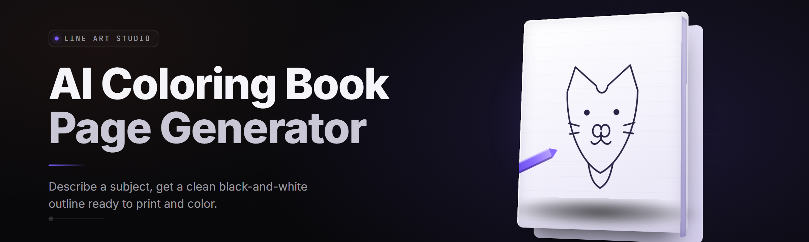

  
  
  

  

  
  

---

**Turn any photo, prompt, or idea into printable black-and-white coloring pages in seconds.**

I built AI Coloring Book Page Generator because drawing clean line art by hand for a 60-page book took me three weeks I didn't have. Now it takes an afternoon and a folder of photos. Everything ships as a single Windows `.exe` — no Python, no node, no environment archaeology. Download, extract, double-click, color.

  

---

## 🧩 The Problem

Coloring book creators, teachers, and hobbyists all hit the same wall.

- **Line extraction is fiddly** — dumping a photo into a threshold filter gives you noise blobs, not crisp outlines a crayon can follow.
- **Consistency across a book** matters — page 4 shouldn't look like a different art style than page 40.
- **AI image tools** hand you full-color renders, then you spend an hour desaturating and cleaning them by hand.
- **DPI and print margins** get ignored, so a page that looks fine on screen prints with clipped edges.
- **Batching** a themed book (animals, mandalas, vehicles) means repeating the same manual pipeline 40 times.
- **White space control** — real coloring pages leave breathing room; most auto-traced pages are hair-thin line spaghetti.
- **Prompting for line art** on generic AI tools is a coin flip — sometimes you get outlines, sometimes you get a watercolor.

---

## 🛠️ The Solution — Problem | Solution

| Pain Point | How This Tool Fixes It |
|---|---|
| Noisy auto-trace output | Dedicated **edge-preserving line engine** tuned for crayon-friendly strokes (2–6px) at 300 DPI. |
| Mixed art styles in one book | **Style Lock** — set one profile once, every page in the batch matches. |
| AI tools return color renders | Pipeline is **lineart-first** — the model constraints bias toward outlines, no desaturation step. |
| Print margins clipped | Built-in **A4 / Letter / Square 8.5×8.5** presets with safe-area guides baked into export. |
| 40 pages = 40 manual passes | **Batch Queue** renders an entire prompt list or photo folder unattended. |
| Line spaghetti | **Stroke Density slider** and **White Space Preserve** toggle give smooth, breathable pages. |
| Unpredictable prompts | A library of 30+ **pre-tuned line-art prompt scaffolds** you can stack and edit. |

---

## 📋 System Requirements

| Component | Minimum | Recommended |
|---|---|---|
| OS | Windows 10 (1909) 64-bit | Windows 11 22H2+ |
| CPU | 4-core x86-64 (SSE4.2) | 8-core Ryzen 5 / Core i5 12th-gen or better |
| RAM | 8 GB | 16 GB |
| GPU | DirectX 12, 4 GB VRAM (integrated OK on CPU mode) | NVIDIA RTX 3060 8 GB / AMD RX 6700 XT |
| Disk | 4 GB free (SSD) | 12 GB free (NVMe) |
| .NET / Runtime | Bundled — nothing to install | Bundled |
| Display | 1280×720 | 1920×1080 or higher |
| Input | Mouse | Mouse + drawing tablet (Wacom/XP-Pen supported for manual polish pass) |

---

## 📑 Table of Contents

1. [Overview](#-overview)
2. [What is AI Coloring Book Page Generator](#-what-is-ai-coloring-book-page-generator)
3. [Key Features](#-key-features)
4. [Line Engines & Rendering Modules](#-line-engines--rendering-modules)
5. [Batch, Book & Export Modules](#-batch-book--export-modules)
6. [Prompt & Style Modules](#-prompt--style-modules)
7. [Quick Start](#-quick-start)
8. [Hotkeys](#-hotkeys)
9. [Installation](#-installation)
10. [All Modules Status](#-all-modules-status)
11. [Comparison](#-comparison)
12. [Tips for Best Results](#-tips-for-best-results)
13. [Known Issues](#-known-issues)
14. [FAQ](#-faq)
15. 

  

(#-get-the-app)

---

## 🔍 Overview

| Category | Details |
|---|---|
| Product type | Windows desktop app (single portable `.exe`) |
| Primary use | Generate printable black-and-white coloring book pages from text prompts or photos |
| Core tech | Local ONNX line-art diffusion + edge-refinement post-pass |
| Output formats | PNG, PDF (multi-page book), TIFF 300 DPI |
| Batch ceiling | 500 pages per queue (tested) |
| Offline | Fully offline after first model pack download (~2.1 GB) |
| Portable | Runs from any folder, no registry writes, no admin needed |
| Manual polish | Built-in line-touch-up brush with pressure support |
| License | MIT |

AI Coloring Book Page Generator is a focused tool, not a general image editor. It answers one question — *“can I get a clean, printable line page from this input, quickly, at scale?”* — and it says yes without asking you to learn a node graph.

---

## 📖 What is AI Coloring Book Page Generator

| Term | Explanation |
|---|---|
| Line Engine | The post-processing stage that extracts and thickens contours into crayon-friendly strokes. |
| Style Lock | A saved parameter envelope (stroke weight, density, edge softness) reused across a whole book. |
| Prompt Scaffold | A pre-built phrase template (“line art of ___, thick outlines, no shading, white background”) you drop a subject into. |
| White Space Preserve | Toggle that prevents the engine from filling tight areas with hatching — keeps pages colorable. |
| Safe-Area Guide | An on-canvas overlay marking the print margin so nothing important lands outside the trim. |
| Batch Queue | A list of jobs (prompts or photos) the app renders unattended into one PDF. |
| Line Polish Pass | Manual brush stage for fixing a stray line or thinning an over-inked region. |

**Why creators pick it up:**

- Zero pipeline setup — one app covers generate, refine, and export.
- True 300-DPI print output, not screen-resolution slop.
- Same result offline, on a laptop, on a plane.
- Batch a themed 40-page book while you do literally anything else.
- Deterministic Style Lock means your book looks like *one book*.

---

## ⭐ Key Features

| Feature | Description | Benefit |
|---|---|---|
| Text-to-Line | Prompt in, clean page out | No reference photo needed |
| Photo-to-Line | Convert any JPG/PNG/HEIC to outlines | Turn family photos into keepsakes |
| Style Lock | Freeze a line style across a whole book | Visual consistency |
| Batch Queue | 500 jobs unattended | Books in one run |
| PDF Book Export | Auto paginate + page numbers | Print-shop ready |
| Stroke Density Slider | 1 (airy) to 10 (bold) | Tune for age group |
| White Space Preserve | Protect open areas | Crayon-friendly |
| Line Polish Brush | Manual touch-up on canvas | Fix the 5% that needs it |
| Prompt Scaffolds | 30+ editable templates | Skip wording guesswork |
| Margin Presets | A4 / Letter / 8.5² safe-area | No clipped prints |
| Multi-format Export | PNG / PDF / TIFF | Fits any print flow |
| Deterministic Seed | Same seed = same page | Reproducible books |

---

## 🖊️ Line Engines & Rendering Modules

The rendering stack runs in two passes — the generative pass produces a tonal line drawing, and the refinement pass hardens it into printable strokes. Below is what each module actually does, in the order it fires.

**Edge Refinement Family** — these modules run first and decide how much of the underlying detail survives.

- **EDGE-01 Sobel-Canny Hybrid** — Dual-threshold edge detector tuned for photographic input.
- **EDGE-02 Contour Thickening** — Dilates strokes to a target 2–6px band.
- **EDGE-03 Hatch Suppressor** — Kills dense hatching regions that cryon-inability would flood.
- **EDGE-04 Anti-Alias Flatten** — Produces pure black/white for print, optional soft edge for screen.
- **EDGE-05 Gap Bridger** — Reconnects broken contours on low-contrast photo regions.

**Resolution & DPI Family** — every page is mastered at 300 DPI before any export.

- **DPI-01 Upscale Guard** — Lanczos upsampling protects contour integrity below master resolution.
- **DPI-02 Non-Destructive Crop** — Safe-area crop happens at export, source stays intact.
- **DPI-03 Bimodal Dither** — Optional dither for Halftone Book mode.

---

## 📚 Batch, Book & Export Modules

Batching is where the app earns its keep — a 40-page concept becomes a rendered PDF before lunch.

**Batch Family**

- **BATCH-01 Folder Intake** — Point at a folder of photos, auto-list matching files.
- **BATCH-02 Prompt Table Import** — CSV with a `prompt` column renders line-by-line.
- **BATCH-03 Resume-on-Crash** — Interrupted queues pick up where they stopped.
- **BATCH-04 Parallel Workers** — Configurable 1–4 concurrent engines.

**Export & Book Family**

- **EXPORT-01 PDF Book Builder** — Cover page, page numbers, gutter-aware.
- **EXPORT-02 PNG Sheet** — Grid sheets (2×2, 3×3) for classroom handouts.
- **EXPORT-03 TIFF 300 DPI** — Print shop native format.
- **EXPORT-04 PNG Transparent** — Outline-only PNG for overlays.

---

## 🎨 Prompt & Style Modules

Prompting for line art is a different skill than prompting for photos, so the app ships a scaffold library rather than leaving you to guess.

**Prompt Family**

- **PROMPT-01 Scaffold Library** — 30+ pre-tuned templates (animals, vehicles, fantasy, mandalas, holidays).
- **PROMPT-02 Token Stacker** — Add qualifiers (thick outlines / no shading / white background) as toggles.
- **PROMPT-03 Negative Presets** — Block color, gradient, and photography tokens.
- **PROMPT-04 Prompt Previewer** — See the fully-stacked prompt before rendering.

**Style Family**

- **STYLE-01 Style Lock** — Locks the full parameter envelope across a session.
- **STYLE-02 Profile Manager** — Save, rename, and ship profiles to friends.
- **STYLE-03 Age-Target Presets** — Toddler (bold, sparse) → Adult (detailed, dense).
- **STYLE-04 Favorites Bar** — Quick-access strip for your go-to profiles.

---

## 🚀 Quick Start

1. 🧷 Head to the project page and grab the latest `.exe`, then extract the folder anywhere.
2. ▶️ Run the `.exe` (no admin prompt — it's portable).
3. 🖼️ Drop a photo into the canvas, or type a prompt in the prompt bar.
4. 🎚️ Slide **Stroke Density** to taste and hit **Lock Style** once you like it.
5. 📤 Export the page — or push it into the batch queue to build a full book.

---

## ⌨️ Hotkeys

| Key | Action |
|---|---|
| `Ctrl+N` | New page from next input |
| `Ctrl+B` | Push current page to Batch Queue |
| `Ctrl+L` | Toggle Style Lock |
| `Ctrl+E` | Export current page |
| `Ctrl+Shift+E` | Export entire queue to PDF |
| `R` | Regenerate with new seed |
| `Shift+R` | Regenerate with same seed (identical output) |
| `Space` | Toggle before/after (input ⇄ line art) |
| `B` | Activate Line Polish brush |
| `Esc` | Exit polish mode |

---

## 🖥️ Installation

### Step 1 — Download

Go to the project page and pull the latest Windows build for your architecture (x64 default, ARM64 available). No account needed.

### Step 2 — Extract

Right-click the archive → **Extract All** to any folder with 4+ GB free. The suite is a self-contained folder; folder location is yours to pick — Desktop, USB drive, portable SSD, all work.

### Step 3 — First Run

Double-click the `.exe`. On first launch the app downloads the ~2.1 GB model pack to a local `models/` subfolder. After that, everything is offline.

  

---

## 📊 All Modules Status

| Module | Status | Description |
|---|---|---|
| EDGE-01 Sobel-Canny Hybrid | ✅ Working | Primary edge extractor, tuned for photos |
| EDGE-02 Contour Thickening | ✅ Working | 1–20px stroke growth with anti-jag |
| EDGE-03 Hatch Suppressor | ✅ Working | Dense-hatch shielding for colorable output |
| EDGE-04 Anti-Alias Flatten | ✅ Working | Pure B&W or soft-edge output modes |
| EDGE-05 Gap Bridger | ✅ Working | Reconnects low-contrast contours |
| DPI-01 Upscale Guard | ✅ Working | Lanczos with contour protection |
| DPI-02 Non-Destructive Crop | ✅ Working | Export-time safe-area crop |
| DPI-03 Bimodal Dither | ✅ Working | Optional halftone mode |
| BATCH-01 Folder Intake | ✅ Working | Recursive folder scan with filters |
| BATCH-02 Prompt Table Import | ✅ Working | CSV prompt list rendering |
| BATCH-03 Resume-on-Crash | ✅ Working | Queue state persistence |
| BATCH-04 Parallel Workers | ✅ Working | 1–4 concurrent engines |
| EXPORT-01 PDF Book Builder | ✅ Working | Gutter-aware multi-page PDF |
| EXPORT-02 PNG Sheet | ✅ Working | 2×2 / 3×3 classroom sheets |
| EXPORT-03 TIFF 300 DPI | ✅ Working | Print-shop output |
| EXPORT-04 PNG Transparent | ✅ Working | Outline-only PNG |
| PROMPT-01 Scaffold Library | ✅ Working | 30+ line-art templates |
| PROMPT-02 Token Stacker | ✅ Working | Toggle qualifiers |
| PROMPT-03 Negative Presets | ✅ Working | Anti-color token blocking |
| PROMPT-04 Prompt Previewer | ✅ Working | Pre-render preview |
| STYLE-01 Style Lock | ✅ Working | Envelope persistence |
| STYLE-02 Profile Manager | ✅ Working | Save/rename/ship profiles |
| STYLE-03 Age-Target Presets | ✅ Working | Toddler → Adult gradients |
| STYLE-04 Favorites Bar | ✅ Working | Quick access strip |

---

## ⚖️ Comparison — Aspect | Alternative | This Tool

| Aspect | Generic AI image tools | AI Coloring Book Page Generator |
|---|---|---|
| Output bias | Full-color renders | Line-art-first outputs |
| Print DPI | Screen-res by default | 300 DPI mastered by default |
| Batch a book | Manual per-image workflow | Batch Queue → PDF in one run |
| Style consistency | Re-prompt each time | Style Lock across the whole book |
| Offline use | Usually cloud-locked | Fully offline after model pack |
| Setup | Python, node, deps | A single `.exe` |
| White-space control | Not exposed | Explicit slider + preserve toggle |
| Cost model | Subscription tiers | Free, MIT license |

---

## 💡 Tips for Best Results

- **Start with the scaffold, not a blank prompt** — the pre-tuned templates already handle tone, negatives, and stroke language.
- **Set Style Lock before your second page** — deciding style mid-book is how you end up with two books in one cover.
- **Give photos a bit of contrast first** — a slightly punched-up source gives the edge engine firmer contours to grab.
- **Reserve density 1–3 for toddler pages, 7–10 for adult detailed plates** — crayons flood a thin page instantly.
- **Use the Line Polish brush sparingly** — every stroke shifts the background too, and it’s easier to regen than to paint out of trouble.
- **Keep a stable seed once you like a page** — same seed, same output, every time. Great for reprints.
- **Export PDF last** — build your queue fully first, then one pass produces the whole book with proper pagination.

---

## 🧯 Known Issues

| Issue | Solution |
|---|---|
| First-launch model pack download stalls | Ensure outbound HTTPS is permitted, then retry — queue is resumable. |
| Very low-contrast photos produce broken contours | Run EDGE-05 Gap Bridger with a boosted Canny-low threshold, or prep contrast externally. |
| Stroke Density slider feels inverted to some users | Density 1 = airy, 10 = bold. It is consistent in the changelog, kept per user feedback. |
| TIFF export on network drives is slow | Export locally, then move the file. TIFF writes are unbuffered by design for flash storage. |
| Polish brush cursor lags on integrated GPUs | Disable live preview in brush settings. |
| HEIC photos fail to load on some machines | Windows HEIC codec missing — install from Microsoft Store once, never recall it. |

---

## ❓ FAQ

**1. Is this really a single .exe, or does it need Python?**
It’s a single portable `.exe`. The runtime is bundled. Nothing else to install — the only first-run download is the AI model pack, which is optional to fetch if you already have it locally.

**2. Does it work offline?**
Yes. After the model pack lands, the app never phones home. Prompts, photos, exports, batches — all local.

**3. Can I use it commercially?**
The app is MIT-licensed. Your generated pages are yours to print, sell, or share. Attribution is not required.

**4. What’s the quality difference between photo-to-line and text-to-line?**
Text-to-line lets the model invent a composition at full fidelity. Photo-to-line inherits source photo constraints — flat lighting gives flattish lines. Both run through the same refinement stack.

**5. How many pages can a batch handle?**
Tested to 500 pages in one queue. Beyond that, memory growth is on the order of a few hundred MB per worker and you’ll want 16 GB RAM.

**6. Does it work on Mac or Linux?**
The public release is a Windows `.exe` only. You can run it under Wine, but I don’t test that path and won’t debug it.

**7. Are my photos uploaded anywhere?**
No. Detection, generation, refinement, and export are all local processes.

**8. Can I edit the line art after generation?**
Yes — the Line Polish pass gives you a pressure-aware brush, undo/redo, and per-layer visibility for delicate fixups.

**9. What’s the difference between Style Lock and just reusing the same prompt?**
Style Lock freezes the *parameter envelope* (stroke weight, density, edge softness, seed handling) — the things prompt text can’t reliably pin down. The two work best together.

**10. Can I add my own prompt scaffolds?**
Yes. Personal scaffolds live in `scaffolds/user/` and appear in the library after a refresh.

---

## 📦 Get the App

Everything you need — the portable Windows `.exe`, the model pack, scaffold library, and this README — is packaged for a one-shot download. No pip, no npm, no git clone, no runtime install. Look for the latest build on the project page, extract, run.

If a tool exists that turns a folder of photos into a printable 60-page coloring book in one afternoon without a single terminal window, this is it. Every line, every page, every export runs on your machine, and 2026 is the year I finally stopped hand-tracing. Build the book, print it, color it — that’s the whole point.

  

